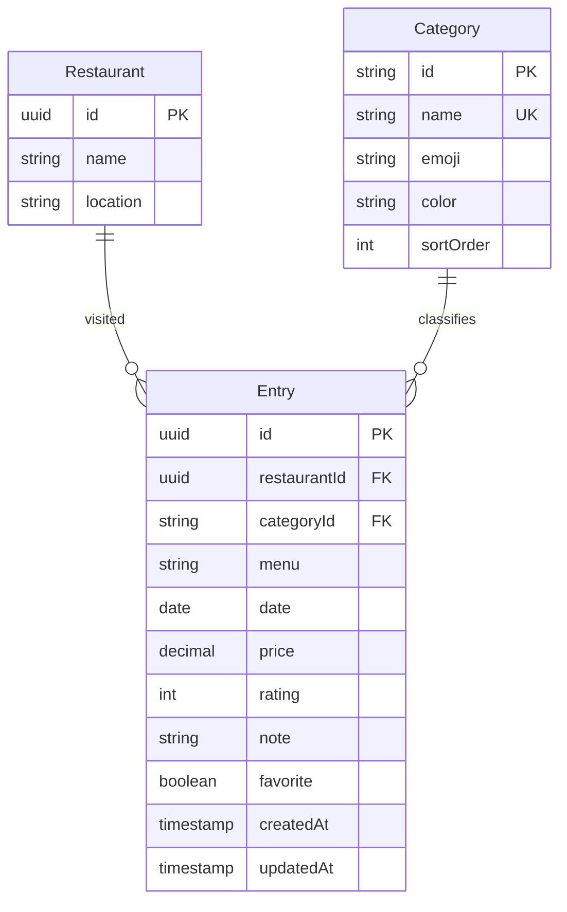

# TasteNote API

NestJS 11 + Prisma ORM 7 + PostgreSQL สำหรับสมุดบันทึกอาหาร TasteNote
Node.js 22.12+ และ pnpm 10.13.1

## เริ่มใช้งาน

```sh
pnpm install
cp .env.example .env
docker compose up -d --wait
pnpm db:generate
pnpm db:deploy
pnpm db:seed
pnpm start:dev
```

หาก Docker รุ่นเก่าไม่รองรับ `--wait` ให้ใช้ `docker compose up -d` แล้วรอ PostgreSQL พร้อมก่อน deploy migration
หากใช้ PostgreSQL ที่มีอยู่แล้ว ให้เปลี่ยน `DATABASE_URL` ใน `.env` และข้าม Docker
ใช้พอร์ตฐานข้อมูล 5433 เพื่อแยกจาก PostgreSQL ทั่วไป ส่วน API ใช้ 3001 และเว็บใช้ 3000

- API: http://localhost:3001/api/v1
- Swagger UI: http://localhost:3001/api/docs
- OpenAPI JSON: http://localhost:3001/api/docs-json
- Database browser: `pnpm db:studio`

API เริ่มต้นฟังเฉพาะ `127.0.0.1` และยังเป็นสมุดบันทึกเดียว ไม่มี login/ownership
หากเพิ่มผู้ใช้หลายคน ให้เพิ่ม User + ownerId และ authentication guard ก่อนเปิด API ให้ใช้งานร่วมกัน
CORS_ORIGIN กำหนดหลาย origin ได้ด้วย comma; CORS ไม่ใช่ระบบ authentication

## โครงสร้าง

```text
src/
  config/        ตรวจ env, CORS และ global validation
  prisma/        Prisma provider, connection lifecycle และ error filter
  entries/       Controller, service และ DTO ของบันทึก
  categories/    รายการหมวดหมู่และสี/emoji
  health/        ตรวจการเชื่อมต่อฐานข้อมูล
prisma/
  schema.prisma  ร่างโมเดลฐานข้อมูล
  migrations/    Initial SQL migration และ constraints
  seed.ts        หมวดหมู่ + ตัวอย่าง 6 มื้อจากเว็บเดิม
  fixtures/      ข้อมูลตัวอย่างที่ไม่ผูกกับไฟล์ของ frontend
test/           HTTP tests ใช้ mocked Prisma ไม่ต้องมี PostgreSQL
```

## ร่างฐานข้อมูล



- Restaurant แยกตามชื่อ + สถานที่ด้วย compound unique key; ไปซ้ำร้านเดิมสร้าง Entry ใหม่
- เมนูเป็นชื่อ ณ วันที่กิน จึงเก็บใน Entry โดยยังไม่เพิ่มตาราง Menu
- วันที่เป็น PostgreSQL DATE และส่งออก `YYYY-MM-DD` เพื่อไม่เลื่อนวันตาม timezone
- ราคาเป็น Decimal(10,2) หน่วยบาท; HTTP ส่งเป็น number ให้ตรงกับเว็บ
- คะแนนเป็น integer 1–5 และราคาต้องไม่ติดลบ มี validation ทั้ง API และ SQL CHECK
- รายการโปรดอยู่ที่แต่ละมื้อ ให้ตรงกับพฤติกรรมของเว็บปัจจุบัน
- หมวดหมู่เป็น lookup table พร้อม emoji/color; API เป็นผู้ออกค่าเหล่านี้แทนรับจาก client
- ลบร้าน/หมวดหมู่ที่ยังมี Entry ไม่ได้ ส่วนลบ Entry จะไม่ลบร้าน
- seed รันซ้ำได้ด้วย stable UUID และไม่เขียนทับ Entry ที่แก้แล้ว

## Endpoints

| Method | Path (ต่อจาก `/api/v1`) | ใช้งาน                                        |
| ------ | ----------------------- | --------------------------------------------- |
| GET    | `/health`               | ตรวจ DB; 200 พร้อมใช้งาน, 503 เชื่อมต่อไม่ได้ |
| GET    | `/categories`           | รายการหมวดหมู่ภาษาไทยพร้อม emoji/color        |
| GET    | `/entries`              | ค้นหา กรอง เรียงลำดับ และ pagination          |
| GET    | `/entries/summary`      | totalEntries, visitedRestaurants, favorites   |
| GET    | `/entries/:id`          | อ่านบันทึก                                    |
| POST   | `/entries`              | สร้างบันทึก                                   |
| PATCH  | `/entries/:id`          | แก้ไขบางฟิลด์ รวม favorite                    |
| DELETE | `/entries/:id`          | ลบสำเร็จตอบ 204                               |

ตัวอย่างสร้างบันทึก:

```sh
curl -X POST http://localhost:3001/api/v1/entries \
  -H 'Content-Type: application/json' \
  -d '{"restaurant":"บ้านพาสต้า","location":"อารีย์, กรุงเทพฯ","menu":"Truffle cream pasta","category":"อาหารฝรั่ง","date":"2026-10-04","price":320,"rating":5,"note":"กลิ่นทรัฟเฟิลชัดมาก","favorite":true}'
```

ชื่อหมวดหมู่ต้องตรงกับ `GET /categories` ฟิลด์ที่ client ส่งได้คือ restaurant, location, menu, category, date, price, rating, note, favorite; id/emoji/color เป็น server-generated

ตัวอย่าง query: `/entries?search=pasta&favorite=true&sort=rating&page=1&limit=20`
รองรับ category (ชื่อภาษาไทย), sort=`date` หรือ `rating`; limit สูงสุด 100

```json
{
  "data": [
    {
      "id": "uuid",
      "restaurant": "บ้านพาสต้า",
      "location": "อารีย์, กรุงเทพฯ",
      "menu": "Truffle cream pasta",
      "category": "อาหารฝรั่ง",
      "date": "2026-10-04",
      "price": 320,
      "rating": 5,
      "note": "อร่อย",
      "favorite": true,
      "emoji": "🍝",
      "color": "peach"
    }
  ],
  "meta": { "page": 1, "limit": 20, "total": 1, "totalPages": 1 }
}
```

ข้อมูลแต่ละรายการตรงกับ shape ของเว็บเดิม แต่ frontend ยังใช้ localStorage และยังไม่ได้เชื่อม API นี้
การเชื่อมต่อภายหลังต้องอ่าน `.data` และใช้ pagination แทนโหลดรายการทั้งหมด

## พัฒนาและตรวจสอบ

```sh
pnpm db:validate
pnpm build
pnpm typecheck
pnpm lint
pnpm format:check
pnpm test
```

HTTP tests ตรวจ DTO, วันที่จริง, false ใน query, pagination, serialization, 404, CRUD, CORS และ health โดยใช้ mocked database; ไม่ถือเป็นการทดสอบ PostgreSQL จริง

หลังแก้ schema ใช้ `pnpm db:migrate --name describe_change` เพื่อสร้าง migration ใหม่ใน development แล้ว `pnpm db:generate`
ใช้ `pnpm db:deploy` เพื่อใช้ migrations ที่มีแล้ว; คำสั่งนี้ไม่สร้าง migration ใหม่
Prisma 7 แยก connection URL ไป `prisma.config.ts` และใช้ `@prisma/adapter-pg` ที่ runtime

เอกสารอ้างอิง: [NestJS Prisma integration](https://docs.nestjs.com/recipes/prisma), [Prisma 7 NestJS guide](https://www.prisma.io/docs/guides/v7/frameworks/nestjs)
